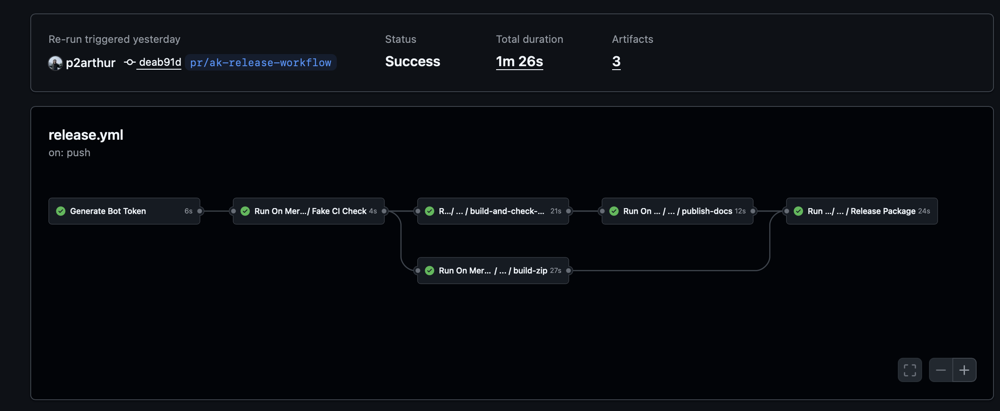

# Algokit Shared CI/CD: Graduating from MakerX

## Experiment repos and branches

- Algokit shared config - Holds the reusable workflows and composable actions.
  https://github.com/algorandfoundation/algokit-shared-config/tree/ci/release-workflow/.github/workflows

  - on-main-merge.yml workflow is supposed to orchestrate the often repeated release.yml local workflow

- Algokit subscriber - Has the code to call the reusable complex on-merge-main workflow -https://github.com/p2arthur/algokit-subscriber-ts-forked/tree/pr/ak-release-workflow

## 1. The Vision & Strategy

### Goal

Centralize and standardize our core CI/CD processes for all Algokit TypeScript repositories, starting with the **on-main-merge** workflow.

### Strategic Move

This initiative directly supports **graduating our dependency from MakerX**.

- **Control:** Moving from External (MakerX) to Internal (`algokit-shared-config`) gives us full control over release logic and updates.
- **Maintenance:** Moving from Distributed to Centralized provides a single source of truth for all CI logic.
- **Efficiency:** Moving from Ad-hoc to Optimized Orchestration enables better performance via structured parallelization.

---

## 2. The Problem: Boilerplate & Duplication

Before, every TypeScript repository had to maintain a large, complex, and nearly identical workflow to handle the merge-to-main logic:

- Node setup
- Lint/Test/Build sequencing
- Artifact creation/upload
- Semantic Release setup and execution

> Goal: Remove the Logic, Keep the Contract.

---

## 3. The Solution: The Local Caller (Project-Specific)

The local repository's workflow is now reduced to a minimal wrapper. It handles **only** the project-specific secrets and security steps, then delegates the rest to the shared workflow.

_The local caller workflow (`on-main-merge.yml`) defines two main jobs:_

1.  **Generate Bot Token:** Securely creates a temporary, job-scoped bot token.
2.  **On Main Merge:** Calls the reusable workflow (`algorandfoundation/algokit-shared-config/.github/workflows/on-merge-main.yml`), passing required secrets and the generated bot token.

> Key Takeaway: The local repo is now cleaner and only handles the secrets needed to satisfy the shared contract.

---

## 4. The Implementation: Shared Logic (The Workhorse)

The core logic lives in `algokit-shared-config`. The `on-merge-main.yml` orchestrates the entire process (Build, Test, Release) and utilizes other reusable workflows and actions.

### Key Shared Components Found

While centralizing the workflows, we've also created and leveraged numerous reusable actions and configurations for standardization across projects:

- **Core Workflows (`.github/workflows/`):**

  - `on-merge-main.yml`: The primary entry point for merges.
  - `release-package.yml`: Encapsulates core release logic.
  - `build-and-publish-docs.yml` / `check-docs.yml`: Standardized documentation pipelines.
  - `node-ci.yml` / `node-build-zip.yml`: Standardized build and CI patterns.

- **Reusable Actions & Configs (`.github/actions/`):**
  - `release-package`: Action containing Semantic Release logic and necessary `package.json` configurations.
  - `generate-typescript-docs`: Action leveraging base configuration files (`typedoc.base.json`, `generate-typedoc-config.js`) for standardized Typedoc generation.
  - `publish-docs`, `run-build`, `archive-artifact`, `setup-node-auth`: Utility actions for consistent steps across repositories.

### Example: Reusable `release-package.yml`

This file encapsulates all the complex steps (downloading artifacts, setting up git, installing tools, running semantic-release). It runs as a `composite` action, taking `BOT_TOKEN` and `NPM_TOKEN` as inputs and using them in the `semantic-release` step.

> Key Takeaway: This composite action is now a standardized, versioned release API that every repository consumes. We only update node-version, actions/@v versions, or semantic-release logic here.

---

## 5. The Demo: Orchestration Flow - https://github.com/p2arthur/algokit-subscriber-ts-forked/actions/runs/20230962845

Demonstrate the execution flow:

1.  **Start:** The local `on-main-merge.yml` execution.
2.  **Job 1 (Local):** Show the quick execution of **Generate Bot Token**.
3.  **Job 2 (Reusable Call):** Click on the **Run Shared On Merge Main Workflow** job.
4.  **Orchestration View:** Point out that the execution now shows the steps defined in the reusable workflow (`algokit-shared-config`).
5.  **Parallelization:** If the main reusable workflow orchestrates parallel jobs (e.g., build and test running simultaneously, followed by release), highlight how this structure improves overall CI time.
6.  **Transparency:** Show that the secrets (BOT_TOKEN, NPM_TOKEN) are passed securely as inputs.

---

## 6. Next Steps

### Moving Forward with Reusable Workflows

- Integrate this pattern into all core Algokit TypeScript repositories.
- Abstract other common CI/CD patterns to run for **Python projects**, extending the benefits of standardization beyond TypeScript.
